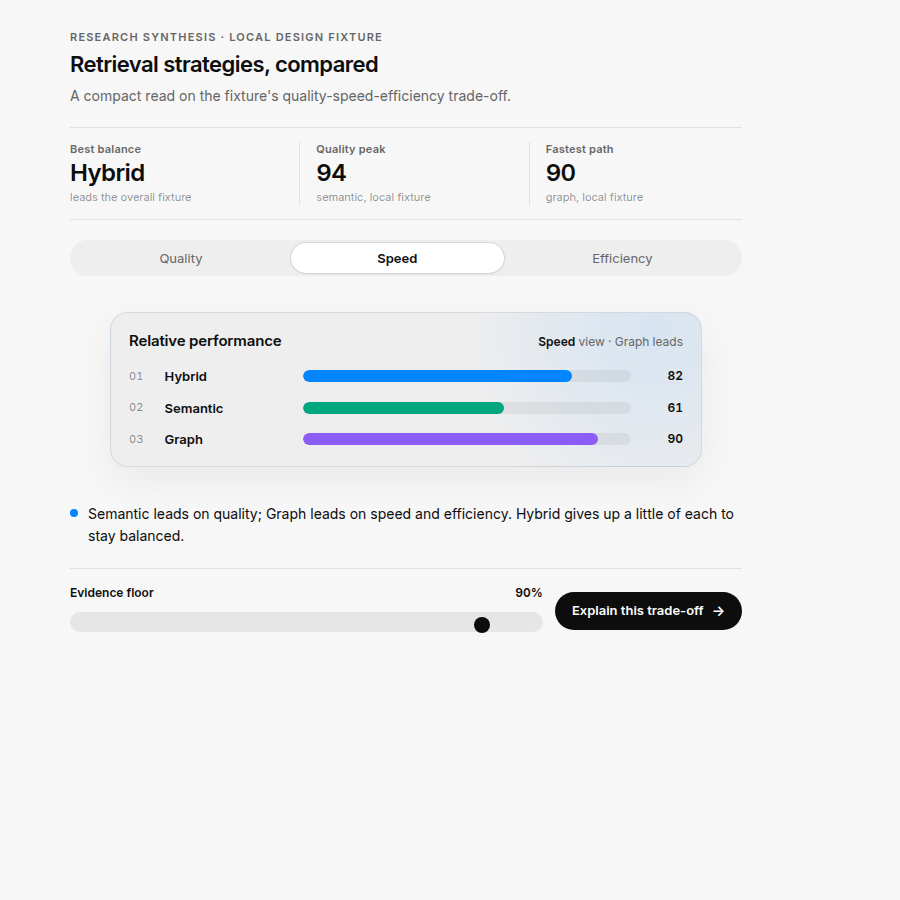

<h1 align="center">Hermes OpenUI</h1>

<p align="center"><strong>Interactive answers that render while Hermes is still writing them.</strong></p>

<p align="center">
  <a href="LICENSE"></a>
  <a href="https://github.com/NousResearch/hermes-agent"></a>
</p>

<p align="center">
  <a href="docs/INSTALL.md">Install</a> ·
  <a href="docs/QUERY.md">Query data</a> ·
  <a href="docs/PROTOCOL.md">Streaming protocol</a>
</p>

Hermes OpenUI is a standalone Hermes plugin and authoring Skill. It turns a
normal assistant reply into a live page with charts, tables, maps, calculators,
checklists, diagrams, and controls that update locally.

<p align="center">
  <a href="docs/assets/openui-demo.png">
    
  </a>
</p>

<p align="center"><sub>Synthetic browser-test fixture. The displayed scores are illustrative, not measured benchmarks.</sub></p>

## Install

Hermes **0.23.1 or newer** and Python **3.10 or newer** are required. Node.js
**22.15.0 or newer** and npm are needed only when building or testing the
source checkout. The installer looks for `hermes` on `PATH`; set `HERMES_BIN`
to use another executable.

### Prebuilt v0.1.1

Download the versioned archive, extract it, and run the shared install steps
from the directory containing `plugin.yaml`:

[Download hermes-openui-v0.1.1.zip](https://github.com/Micraow/hermes-openui/releases/download/v0.1.1/hermes-openui-v0.1.1.zip)

```sh
unzip hermes-openui-v0.1.1.zip
cd hermes-openui
```

### From source

```sh
git clone https://github.com/Micraow/hermes-openui.git
cd hermes-openui
npm ci
npm run build
```

### Install and check

From the archive or source directory:

```sh
export HERMES_HOME="${HERMES_HOME:-$HOME/.hermes}"
python3 scripts/install.py
```

The installer links the package when the slot is empty, keeps any existing
plugin slot untouched, and uses Hermes' public `plugins doctor` and
`plugins enable` commands. It prints three separate states: **Agent**,
**Skill**, and **Browser**. Browser means the prebuilt browser bundle is complete;
whether Desktop has materialized and activated that build is reported
separately. Use `python3 scripts/install.py --check` for a read-only report.

In Hermes Desktop, run **Reload desktop plugins** if the report says the
browser runtime is pending. Then open **Capabilities → Plugins** and turn on
the Desktop switch for **OpenUI cards** (`hermes-openui`). Hermes keeps this
browser activation off by default and exposes no public command that sets it.
Then start a new chat with:

```text
/hermes-openui:openui Compare hybrid, semantic, and graph retrieval with clearly labeled illustrative scores, and let me switch the metric.
```

The plugin includes the `hermes-openui:openui` Skill and its catalog. Install
them as one package. For named profiles, updates, verification, and
troubleshooting, read [Install Hermes OpenUI](docs/INSTALL.md).

## What it does

- **Streams a usable page.** The answer's root renders as source arrives.
  Controls become interactive after the source completes.
- **Handles ordinary interactions locally.** A slider, tab, filter, calculation,
  clipboard action, marker selection, or checklist update does not start a new
  model turn.
- **Can query one read-only data source.** `Query("query_data", ...)` sends
  model-supplied scalar arguments to the endpoint selected by the Hermes profile
  owner. Returned rows stay in the browser card and do not enter the model
  transcript.
- **Continues only on request.** An explicit `@ToAssistant` or form submit sends
  a new, task-specific message to the same Hermes chat.

The pinned Open Intelligent UI catalog exposes **55 components** and
**59 functions**, including local state, charts, tables, images, maps, SVG,
Markdown, math, a restricted HTML sandbox, citations, photo attribution, and
place links. See the [bundled Skill](skills/openui/SKILL.md) for authoring rules
and [catalog parity](docs/PARITY.md) for host-specific behavior.

## Requirements and limits

- Hermes 0.23.1 or newer is required. No Hermes source patch is needed.
- CoMem is **not required**. If you already use CoMem, it can provide memory or
  context through its own Hermes integration. See
  [github.com/Micraow/CoMem](https://github.com/Micraow/CoMem).
- Models may choose Markdown instead of the bundled Skill. Use
  `/hermes-openui:openui` when the answer must be an OpenUI card.
- The plugin validates the streaming envelope; it does not repair an invalid
  model-generated program. A malformed program ends as
  “Interactive card unavailable.”
- Hermes can replace transcript DOM while a message settles. Card state is
  persisted per session, but a host remount can still reset state. Interactive
  controls are enabled only after the source completes.
- Image search, MapLibre tiles, and street-route overlays need outbound network
  access. Route views are overviews and are not turn-by-turn navigation.
- Citation, photo, and place data comes from the model or a trusted tool. The
  plugin validates URL shape and attribution fields; it does not verify the
  underlying claims.
- Browser acceptance currently covers Chromium. Firefox and WebKit are not in
  the tested matrix.

For Query configuration, endpoint limits, error behavior, and security, read
[Read-only Query data](docs/QUERY.md). Development notes and the deterministic
fixture live in the [streaming protocol guide](docs/PROTOCOL.md).

## Development

Run validation locally before committing; this repository has no cloud CI.
Use a Python environment with `fastapi`, `httpx`, and Pydantic 2 installed
(for example, the environment used by Hermes Webapp).

```sh
npm run typecheck
npm test
npm run test:browser
```

`npm test` covers the TypeScript runtime and Python Query bridge.
`npm run test:browser` uses Chromium; set `CHROMIUM_PATH` when Chromium is not
on the default path.

## License

Hermes OpenUI is MIT licensed. The pinned Open Intelligent UI catalog keeps its
upstream MIT license in
[OPEN-INTELLIGENT-UI-LICENSE.txt](docs/OPEN-INTELLIGENT-UI-LICENSE.txt). See
[third-party notices](THIRD_PARTY_NOTICES.md) for the retained attributions.
